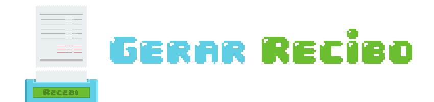

<p align="center">
  
</p>

> Plataforma gratuita para criação de recibos profissionais para estéticas automotivas e lava-jatos — personalize, gere e compartilhe em segundos.

<p align="center">
  <a>
    
  </a>
  <a href="https://opensource.org/licenses/MIT">
    
  </a>
</p>

## 📖 Sobre o Projeto

O **Recebi** é uma ferramenta simples e direta para quem trabalha com estética automotiva ou lava-jato e precisa emitir recibos com aparência profissional, sem complicação. Com uma interface intuitiva, você pode:

- 🧾 Criar recibos personalizados em poucos cliques;
- 🚗 Registrar os serviços prestados com descrição e valores;
- 🏢 Cadastrar os dados do seu negócio e do cliente;
- 🖼️ Inserir sua logo para dar identidade visual ao documento;
- 📄 Nomear o documento como quiser: recibo, orçamento, ordem de serviço, comprovante de pagamento e muito mais.

Acesse: https://recebi-ten.vercel.app

## 🎯 Características

- **Totalmente Personalizável**: Defina o nome do documento, dados do beneficiário, cliente, serviços e valores;
- **Sua Marca no Recibo**: Adicione a logo do seu negócio para um resultado mais profissional;
- **Múltiplos Tipos de Documento**: Gere recibos, orçamentos, comprovantes de pagamento ou ordens de serviço;
- **Geração Instantânea**: O recibo é gerado na hora, pronto para imprimir ou compartilhar;
- **Sem Cadastro**: Nenhuma conta necessária. Abriu, preencheu, gerou;
- **Responsivo**: Funciona em celular, tablet e computador.

## 💡 Por que o Recebi existe?

Grande parte dos lava-jatos e estéticas automotivas são negócios pequenos, muitas vezes sem CNPJ, sem sistema de gestão e sem uma forma simples de registrar os atendimentos. No fim do mês, na hora de organizar as entradas ou declarar os rendimentos, a dificuldade aparece: onde estão os comprovantes? Quanto foi cobrado em cada serviço?

O **Recebi** existe para esse público. Uma ferramenta gratuita, sem burocracia e sem necessidade de cadastro, que permite gerar um recibo profissional em segundos — seja para entregar ao cliente, guardar para o próprio controle ou usar na hora de declarar os rendimentos.

Simples assim. Sem sistema, sem mensalidade, sem complicação.

## 🛠️ Tecnologias Utilizadas

- HTML5
- CSS3
- JavaScript Vanilla

## 🧪 Testes

Os testes end-to-end (E2E) usam [Cypress](https://www.cypress.io/) e estão em `cypress/e2e/` (módulos em `cypress/e2e/modules/` e casos globais na raiz). O ambiente é **100% Docker** — não é necessário instalar Node, Cypress ou Nix no host.

> **Versão do Cypress:** fixada em **16.1.0** pela imagem Docker `cypress/included:16.1.0` e pelo `package.json` (`"cypress": "16.1.0"` sem `^`). Imagem e pacote npm são mantidos na mesma versão.

Documentação de apoio:

- TDD (fonte dos casos): [`docs/TDD_Recebi_Casos_de_Teste.md`](docs/TDD_Recebi_Casos_de_Teste.md)
- Inventário dos 101 casos: [`cypress/e2e/test-tree.md`](cypress/e2e/test-tree.md)
- Progresso por lote: [`cypress/PROGRESSO.md`](cypress/PROGRESSO.md)
- Como rodar: [`docs/COMO_RODAR_TESTES.md`](docs/COMO_RODAR_TESTES.md)

**Status atual (2026-10-28):** lotes 0 a 12 concluídos; 87 testes ativos passando, 6 skips intencionais (DEF mapeados) e 1 caso manual. Próximo: lote 13 (compatibilidade e responsividade).

> **Ambiente Docker:** o Cypress roda no mesmo namespace do app (`network_mode: "service:app"`) e acessa `http://localhost:4173`. Isso evita o bloqueio de Local Network Access do Chrome 142+; não use `http://app:4173`. Detalhes em [`docs/COMO_RODAR_TESTES.md`](docs/COMO_RODAR_TESTES.md).

### Pré-requisitos
- Docker e Docker Compose instalados
- Portas disponíveis: `4173` (app)

### Comandos

#### Subir o app (desenvolvimento)
```bash
docker compose up -d app
```
A aplicação ficará disponível em [http://localhost:4173](http://localhost:4173). As alterações nos arquivos do projeto são refletidas via volume montado.

#### Derrubar tudo
```bash
docker compose down
```

#### Rodar toda a suíte E2E (headless, Chrome)
O serviço `cypress` usa o profile `test` para não subir junto com `docker compose up`. O navegador padrão já é o Chrome; `--browser chrome` deixa a escolha explícita.
```bash
docker compose --profile test run --rm cypress --browser chrome
```
Ou via script npm:
```bash
npm run test:e2e:chrome
```

#### Rodar um spec individual
Escreva/rode os testes um por vez durante o TDD. Exemplo:
```bash
docker compose --profile test run --rm cypress --browser chrome --spec "cypress/e2e/modules/form.cy.js"
```
Ou via script npm:
```bash
npm run test:e2e:spec -- "cypress/e2e/modules/form.cy.js"
```

#### Abrir Cypress (interface gráfica) - opcional/manual
`cypress open` (modo interativo) não é o padrão neste setup. Caso necessário, só pode ser utilizado manualmente pelo usuário com seu próprio ambiente gráfico (X11/Wayland) e configuração adequada fora do escopo automatizado — não há configuração pronta para isso no `docker-compose.yml`.

#### Screenshots e vídeos
São gravados dentro do projeto em `cypress/screenshots/` e `cypress/videos/`. Ambos já estão listados no `.gitignore`.


## 🤝 Como Contribuir

- ⭐ **Dê uma estrela no repositório** — isso ajuda o projeto a crescer!
- 🐛 **Encontrou um bug?** Abra uma issue descrevendo o problema;
- 💡 **Tem uma sugestão?** Todo feedback é bem-vindo;
- 📧 **Entre em contato:** nilton.f.o.junior@gmail.com

## 📝 Licença

Este projeto está sob a licença MIT. Você pode usar, modificar e distribuir livremente.

---

<p align="center">
  "A beleza que vive no ato de compartilhar algo com o outro."
</p>
